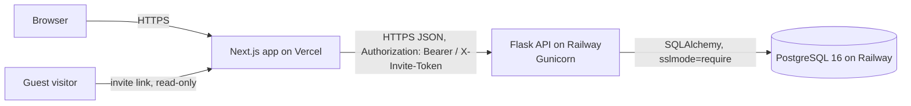
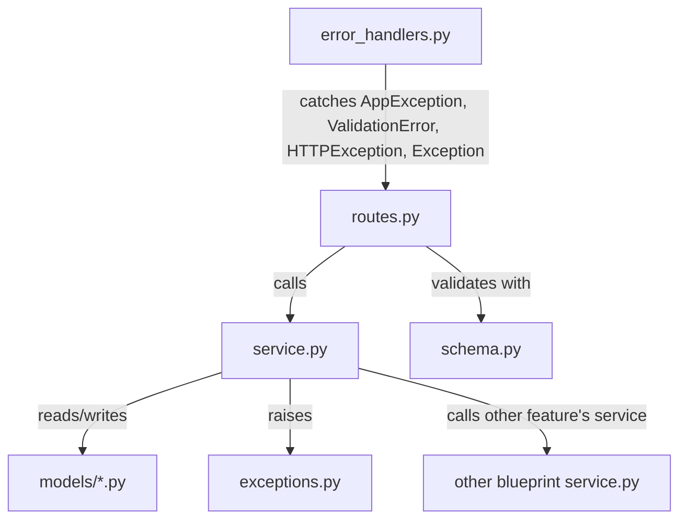
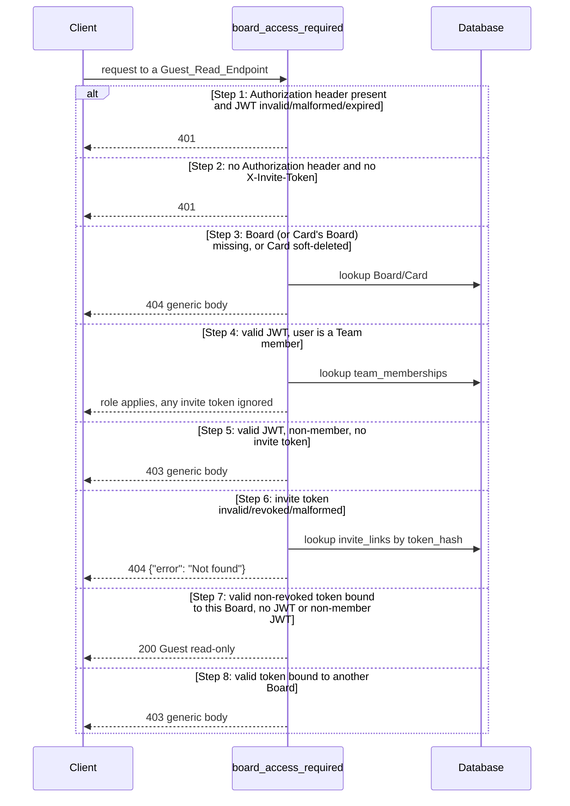
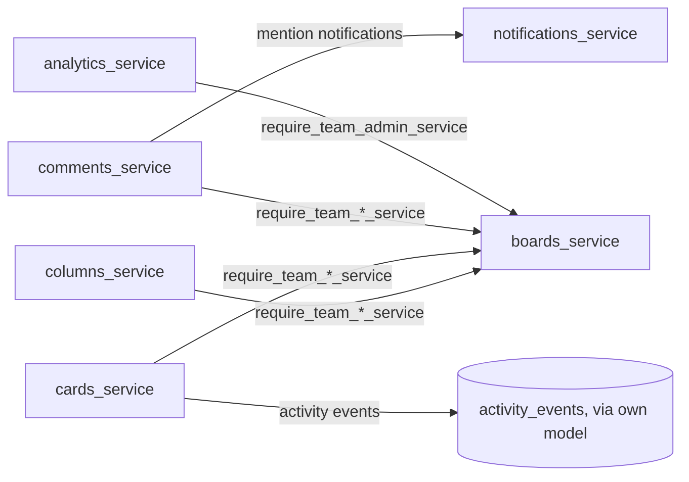
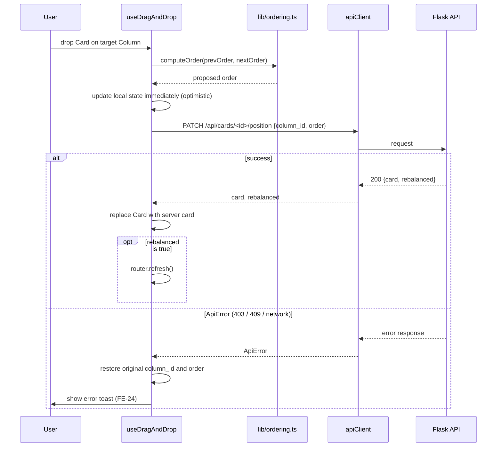
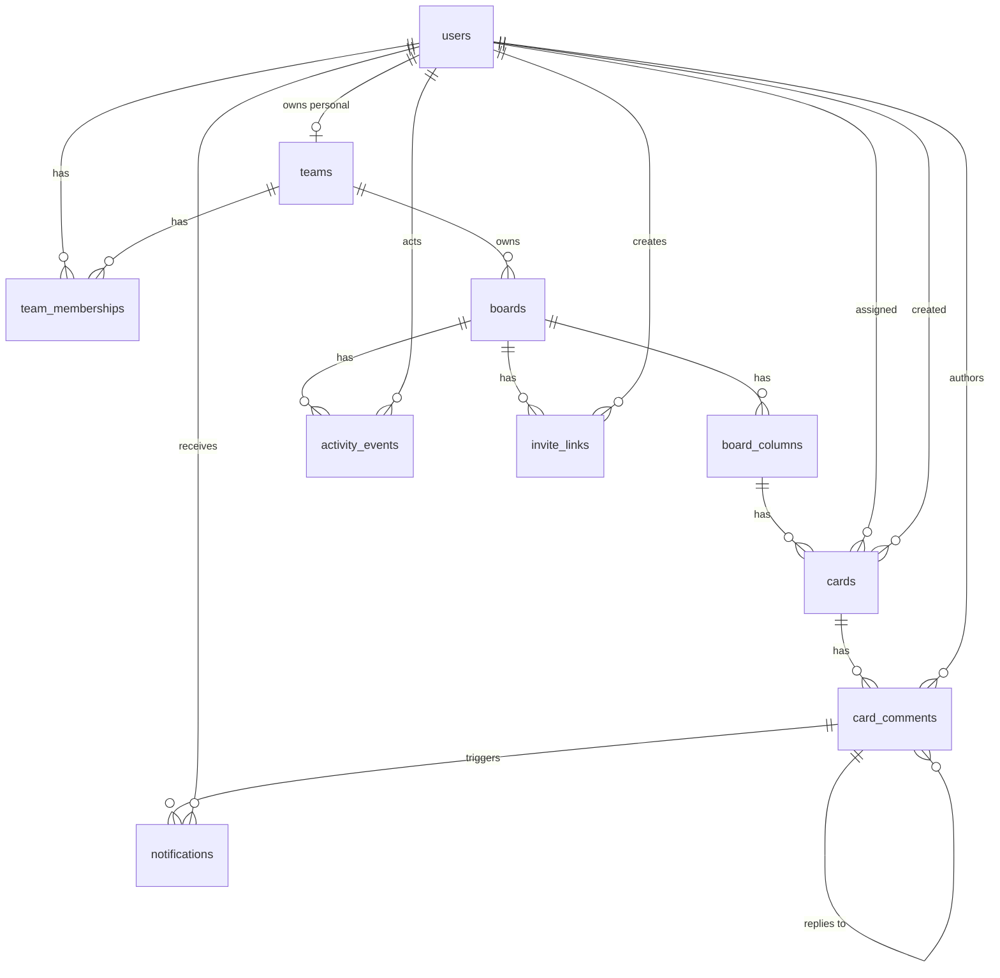

# Design Document — Sevy

Status: design draft for V9 requirements. No application code, migrations, or deployment exists. No command, test, or deployment referenced here has been run; every status is "not run" / "not measured" unless the text says otherwise. This document does not modify `requirements.md`, `CHANGELOG.md`, any steering file, any guideline, or any reference file.

Traceability convention: every acceptance criterion is cited as `R<N>.<k>` exactly as defined in `requirements.md`. Guideline rules are cited by ID (`BE-nn`, `DB-nn`, `FE-nn`, `TC-nn`, `ST-nn`) and are not restated; this document describes architecture and interfaces and points to the owning guideline for the full rule text.

---

## Overview

Sevy is a Trello-like team task management application. A Team owns Boards; Boards hold ordered Columns; Columns hold ordered Cards; Cards carry threaded Comments; mentions create Notifications; Members track their work through My Tasks; Admins view per-Board analytics. A Guest may view one Board read-only through an Invite Link. The product name is **Sevy** throughout this document (see "Source conflicts found" for the `RevoTask` naming in the reference files).

**V1/V2 scope** (Requirement 17): Boards, Columns and Cards with FLOAT ordering, Comments, drag-and-drop, Notifications, Search, Analytics, Card assignment with My Tasks, and Profile (R17.1). Excluded: file attachments, email digests, third-party integrations (R17.2); real-time sync, password change/reset, OAuth/social login, i18n, touch drag-and-drop (R17.3). The API exposes only the 32 routes of Appendix A (R17.4).

**Tech stack** (`tech.md` section 1): Flask 3 + SQLAlchemy 2 + Flask-Migrate + Flask-JWT-Extended + Marshmallow + flask-cors + python-dotenv on Python 3.12, PostgreSQL 16, Gunicorn; Next.js 15 (App Router) + React 19 + TypeScript 5 (strict) + Tailwind CSS 4 + react-hot-toast on Node.js 22 LTS. Only the dependencies allowlisted in `tech.md` TC-02 (backend) and TC-03 (frontend) are used anywhere in this design; no property-based testing library (Hypothesis, fast-check) is proposed because neither is in either allowlist (see section 10).

**Two deployed apps** (Requirement 27): the Flask API on Railway with a Railway PostgreSQL database, and the Next.js app on Vercel, calling the API through `API_BASE_URL` / `NEXT_PUBLIC_API_BASE_URL`.

**Mapping to Requirements 1–29**: Requirements 1–3 (access, permissions, Guest) are realized by the guard decorators and Authorization_Service (section 2.3, 4a); Requirements 4–7 (Boards, Columns, Cards, drag-and-drop) by the boards/columns/cards Blueprints and the FLOAT ordering algorithm (sections 4a, 6.1); Requirement 8 (Comments) and Requirement 9 (Notifications) by the comments/notifications Blueprints (sections 4a, 6.3); Requirement 10 (Search) and Requirement 18 (My Tasks) by the shared `GET /api/cards` route (sections 4a, 6.4); Requirement 11 (Analytics) by the analytics Blueprint (sections 4a, 6.5); Requirement 12 (Team members) and Requirement 19 (Profile) by the boards/users Blueprints; Requirement 13 (Auth) by the auth Blueprint and JWT settings (section 8); Requirements 14–15 (performance, concurrency) by the indexing and query-budget design (section 9); Requirement 16 (tech constraints) by section 1; Requirement 17 (scope) by this section; Requirements 20–25 (API conventions, frontend pages, error handling, responsive layout, completion tracking, shared UI) by sections 4, 5, 6, 7; Requirement 26 (data integrity) by section 5; Requirements 27–29 (deployment, testing, repository) by sections 2.1, 9, 10, 12.

---

## Architecture

### 2.1 System context and deployment



- **Release step** (R27.2): `flask db upgrade` runs before the API serves traffic, applying every committed migration (`backend/migrations/`, `tech.md` TC-10).
- **Env variables** (`tech.md` TC-09): backend reads `FLASK_APP`, `FLASK_DEBUG`, `DATABASE_URL`, `JWT_SECRET_KEY`, `CORS_ORIGINS` from the environment; frontend reads `NEXT_PUBLIC_API_BASE_URL` (browser) and `API_BASE_URL` (server). Both projects commit `.env.example` (`ST-13`); no value is recorded here.
- **CORS** (R27.7, `tech.md` TC-20): `CORS_ORIGINS` is the exact Vercel production origin plus `http://localhost:3000` in development; `*` is never allowed in production.
- **Database connection** (R27.8, `tech.md` TC-10): the hosted `DATABASE_URL` includes `sslmode=require` unless the provider's documentation says otherwise.
- **Health check** (R20.7, R27.3): `GET /api/health` is public and returns `{"data": {"status": "ok"}}`.
- No Railway plan, Gunicorn worker class/count, database plan, or public URL is stated as a fact anywhere in this document; `tech.md` TC-20 records the worker count as a plan (`--workers 2`, no worker class) and no `Procfile` exists yet.

### 2.2 Backend layering



Import direction (`ST-03`, `ST-04`): `routes.py` parses with a schema, calls exactly one `*_service` function, and returns the envelope — no `db.session`, no `.query`, no model import. `service.py` holds business logic and database access, has no `flask` import, and may call another blueprint's `service.py` for cross-feature effects (never another blueprint's `routes.py` or `schema.py`). `schema.py` holds Marshmallow schemas only. `models/*.py` imports only `extensions` and `utils/time.py`. The full rule text is owned by `ST-03` and `ST-04`; this design does not restate it.

### 2.3 Request flow and the Access Resolution Table

Every route carries exactly one guard (`BE-08`): no guard on the three public routes (`POST /api/auth/register`, `POST /api/auth/login`, `GET /api/health`); `@board_access_required(allow_guest_read=True)` on the two Guest read routes (`GET /api/boards/<id>`, `GET /api/cards/<id>/comments`); `@token_required` on every other route.



The eight steps and their order are defined by Requirement 3 (Access Resolution Table) and implemented by `BE-08`; this diagram does not add or remove a step.

### 2.4 Frontend architecture

- **Server Component pages**: `app/page.tsx` (Dashboard) and `app/boards/[id]/page.tsx` (Board Detail) read the JWT from the `sevy_token` cookie with `cookies()` and fetch through `lib/apiClient.ts`, passing data as props to Client Components (`FE-22`).
- **AuthContext** (`FE-19`): `{ user, token, isAuthenticated, login, logout, updateUser }`; `login()` writes the `sevy_token` cookie (`path=/`, `SameSite=Lax`, `max-age=3600`); `logout()` is stateless (`OD-10`).
- **API client** (`FE-23`): single module `apiClient` (`get`, `post`, `patch`, `delete`); attaches `Authorization: Bearer <token>` outside Guest mode; throws `ApiError { statusCode, message }`.
- **Guest_Mode** (`FE-30`, R3.8, R21.11, R21.16, R21.17): `/boards/[id]?invite=<token>` sends only `X-Invite-Token`, never `Authorization`, only to the two Guest read endpoints; `middleware.ts` does not redirect this URL to `/login`.
- **middleware.ts**: redirects an unauthenticated request for `/`, `/boards/*`, `/my-tasks`, `/profile` to `/login`, except the Guest exception above (R21.11).

---

## Repository Layout

Layout is owned by `structure.md` (`ST-01` to `ST-13`); this section summarizes the parts this design relies on and does not redefine them.

```
sevy/
├── .kiro/                      steering, specs working copy, references
├── specs/                      requirements.md design.md tasks.md CHANGELOG.md (submission copy)
├── guidelines/                 frontend.md backend.md database.md VIOLATIONS.md
├── backend/
│   ├── app/
│   │   ├── __init__.py         create_app()
│   │   ├── config.py  extensions.py  exceptions.py  error_handlers.py  logging_config.py  health.py
│   │   ├── models/              user.py team.py team_membership.py board.py board_column.py
│   │   │                        card.py card_comment.py notification.py activity_event.py invite_link.py
│   │   ├── utils/                responses.py  ordering.py  auth.py  time.py
│   │   └── blueprints/           auth/ boards/ columns/ cards/ comments/ notifications/ analytics/ users/
│   │                              (each: __init__.py routes.py service.py schema.py)
│   ├── migrations/
│   ├── tests/
│   │   ├── conftest.py
│   │   ├── unit/<feature>/       test_<feature>_service.py  test_<feature>_routes.py
│   │   ├── e2e/                  test_<flow>.py
│   │   └── load/                 load-test script  RESULTS.md        (`tech.md` TC-23)
│   └── requirements.txt  requirements-dev.txt  Procfile  .flake8  .env.example
├── frontend/
│   ├── app/                      layout.tsx page.tsx globals.css login/ register/ boards/[id]/ my-tasks/ profile/
│   ├── components/                shared/ board/ card/ comments/ notifications/ layout/
│   ├── context/ hooks/ lib/ types/
│   ├── __tests__/                 mirrors components/shared/ and hooks/
│   ├── e2e/                       auth.spec.ts kanban.spec.ts pages.spec.ts
│   └── middleware.ts  playwright.config.ts  .env.example
├── README.md
└── .gitignore
```

None of these paths exists yet; the tree states the target layout only (`ST-01`).

---

## Components and Interfaces

### 4a. Backend Blueprints

Guard legend: **Pub** = no guard (public); **Tok** = `@token_required`; **Guest** = `@board_access_required(allow_guest_read=True)`.

#### auth Blueprint

| Method and path | Guard | Input schema | Output schema | Service function | Status codes | Criteria |
|---|---|---|---|---|---|---|
| `POST /api/auth/register` | Pub | `RegisterSchema` | `UserSchema` | `register_service` | 201, 400, 409 | R13.1, R13.2, R13.3, R13.4 |
| `POST /api/auth/login` | Pub | `LoginSchema` | login payload (`access_token`, `token_type`, `expires_in`, `user`: `UserSchema`) | `login_service` | 200, 400, 401 | R13.5, R13.6, R13.7 |

`POST /api/auth/register` request: `{"name", "username", "email", "password"}`; response `data`: `{"id", "name", "username", "email", "created_at"}` (201). `POST /api/auth/login` request: `{"email", "password"}`; response `data`: `{"access_token", "token_type": "Bearer", "expires_in": 3600, "user": {...}}` (200); invalid credentials: 401 `{"error": "Invalid credentials"}` (R13.7).

#### boards Blueprint

| Method and path | Guard | Input schema | Output schema | Service function | Status codes | Criteria |
|---|---|---|---|---|---|---|
| `POST /api/boards` | Tok | `BoardCreateSchema` | Board (with `columns`) | `create_board_service` | 201, 400, 403 | R4.1–R4.4 |
| `GET /api/boards` | Tok | — | Board list | `list_boards_service` | 200 | R4.5 |
| `GET /api/boards/<id>` | Guest | — | Board detail (Columns→Cards) | `get_board_service` | 200, 403, 404 | R4.6, R3.3–R3.12 |
| `PATCH /api/boards/<id>` | Tok | `BoardUpdateSchema` | Board | `update_board_service` | 200, 400, 403, 404 | R4.7, R4.8 |
| `DELETE /api/boards/<id>` | Tok | — | `{"id"}` | `delete_board_service` | 200, 403, 404 | R4.9 |
| `POST /api/boards/<id>/members` | Tok | `MemberAddSchema` | membership | `add_team_member_service` | 201, 400, 403, 404, 409 | R12.1–R12.3, R12.9 |
| `GET /api/boards/<id>/members` | Tok | — | member list | `list_team_members_service` | 200, 403, 404 | R12.7 |
| `PATCH /api/boards/<id>/members/<user_id>` | Tok | `MemberRoleUpdateSchema` | membership | `update_team_member_role_service` | 200, 400, 403, 404, 409 | R12.4, R12.8, R12.10 |
| `DELETE /api/boards/<id>/members/<user_id>` | Tok | — | `{"id"}` | `remove_team_member_service` | 200, 403, 404, 409 | R12.5, R12.6, R12.8 |
| `POST /api/boards/<id>/invite-links` | Tok | `InviteLinkCreateSchema` | `{"id", "board_id", "token", "created_at"}` | `create_invite_link_service` | 201, 400, 403, 404 | R3.1, R3.2 |
| `DELETE /api/boards/<id>/invite-links/<invite_id>` | Tok | — | `{"id"}` | `revoke_invite_link_service` | 200, 403, 404 | R3.6, R3.7 |

#### columns Blueprint

| Method and path | Guard | Input schema | Output schema | Service function | Status codes | Criteria |
|---|---|---|---|---|---|---|
| `POST /api/boards/<id>/columns` | Tok | `ColumnCreateSchema` | Column | `create_column_service` | 201, 400, 403, 404 | R5.1–R5.3 |
| `PATCH /api/columns/<id>` | Tok | `ColumnUpdateSchema` | Column | `update_column_service` | 200, 400, 403, 404 | R5.5, R2.5, R24.6 |
| `DELETE /api/columns/<id>` | Tok | — | `{"id"}` | `delete_column_service` | 200, 403, 404 | R5.10, R5.11, R2.5 |
| `PATCH /api/boards/<id>/columns/reorder` | Tok | `ColumnReorderSchema` | `{"column", "rebalanced"}` | `reorder_column_service` | 200, 400, 403, 404, 409 | R5.6–R5.9 |

#### cards Blueprint

| Method and path | Guard | Input schema | Output schema | Service function | Status codes | Criteria |
|---|---|---|---|---|---|---|
| `POST /api/columns/<id>/cards` | Tok | `CardCreateSchema` | Card | `create_card_service` | 201, 400, 403, 404 | R6.1–R6.3, R18.1, R18.2, R24.3 |
| `PATCH /api/cards/<id>` | Tok | `CardUpdateSchema` | Card | `update_card_service` | 200, 400, 403, 404 | R6.4, R6.5, R18.1–R18.3 |
| `DELETE /api/cards/<id>` | Tok | — | `{"id"}` | `delete_card_service` | 200, 403, 404 | R6.6, R6.7, R6.16 |
| `PATCH /api/cards/<id>/position` | Tok | `CardPositionSchema` | `{"card", "rebalanced"}` | `move_card_service` | 200, 400, 403, 404, 409 | R7.1–R7.14, R24.2, R24.4, R24.5 |
| `GET /api/cards` | Tok | `CardListQuerySchema` | `CardListItemSchema` list | `search_cards_service` / `list_my_cards_service` | 200, 400, 403, 404 | R10.1–R10.9, R18.5–R18.9 |

#### comments Blueprint

| Method and path | Guard | Input schema | Output schema | Service function | Status codes | Criteria |
|---|---|---|---|---|---|---|
| `POST /api/cards/<id>/comments` | Tok | `CommentCreateSchema` | Comment | `create_comment_service` | 201, 400, 401, 403, 404 | R8.1–R8.6, R8.18, R8.19 |
| `GET /api/cards/<id>/comments` | Guest | — | Comment list | `list_comments_service` | 200, 401, 403, 404 | R8.5, R8.7, R3.3–R3.12 |
| `PATCH /api/comments/<id>` | Tok | `CommentUpdateSchema` | Comment | `update_comment_service` | 200, 400, 403, 404 | R8.8, R8.9 |
| `DELETE /api/comments/<id>` | Tok | — | `{"id"}` | `delete_comment_service` | 200, 403, 404 | R8.9–R8.11 |

#### notifications Blueprint

| Method and path | Guard | Input schema | Output schema | Service function | Status codes | Criteria |
|---|---|---|---|---|---|---|
| `GET /api/notifications` | Tok | `NotificationQuerySchema` | `{"items", "page", "per_page", "total", "total_pages", "unread_count"}` | `list_notifications_service` | 200, 400 | R9.7–R9.9 |
| `PATCH /api/notifications/<id>/read` | Tok | — | Notification | `mark_notification_read_service` | 200, 404 | R9.10–R9.12 |

#### analytics Blueprint

| Method and path | Guard | Input schema | Output schema | Service function | Status codes | Criteria |
|---|---|---|---|---|---|---|
| `GET /api/boards/<id>/analytics` | Tok | `AnalyticsQuerySchema` | `{"cards_per_column", "completed_this_week", "member_activity", "activity_per_day", "start_date", "end_date"}` | `get_board_analytics_service` | 200, 400, 403, 404 | R11.1–R11.9 |

#### users Blueprint

| Method and path | Guard | Input schema | Output schema | Service function | Status codes | Criteria |
|---|---|---|---|---|---|---|
| `GET /api/users/me` | Tok | — | `UserSchema` | `get_current_user_service` | 200 | R19.1 |
| `PATCH /api/users/me` | Tok | `UserUpdateSchema` | `UserSchema` | `update_current_user_service` | 200, 400, 409 | R19.2–R19.6 |

#### app-level

| Method and path | Guard | Input schema | Output schema | Service function | Status codes | Criteria |
|---|---|---|---|---|---|---|
| `GET /api/health` | Pub | — | `{"status": "ok"}` | n/a (`app/health.py`) | 200 | R20.7, R27.3 |

**Route count check**: the eight tables above list 32 routes total (auth 2, boards 11, columns 4, cards 5, comments 4, notifications 2, analytics 1, users 2, app-level 1 = 32), equal to Appendix A per Blueprint.

**Shared utilities**: `app/utils/responses.py` (`success()`, `error()`, `format_validation_error()`, `BE-04`/`BE-07`); `app/utils/ordering.py` (`ORDER_STEP`, `MIN_GAP`, allocation helpers, `BE-14`); `app/utils/auth.py` (`@token_required`, `@board_access_required`, `BE-08`); `app/utils/time.py` (`utc_now()`, `DB-05`). Exceptions catalog: `app/exceptions.py` (`BE-10`). Global handler: `app/error_handlers.py` → `register_error_handlers(app)` (`BE-11`). Logging: `app/logging_config.py` (`BE-12`).

### 4b. Cross-feature service calls



Allowed direction: `service → other blueprint's service.py` only (never `routes.py`/`schema.py` of another blueprint), per `ST-04`. `comments/service.py` calls `notifications/service.py`'s `create_mention_notifications_service(...)` when a Comment mentions a Team member (R9.1); `boards/service.py` exposes `require_team_member_service` / `require_team_admin_service`, called by `columns`, `cards`, `comments`, `analytics` services (`BE-09`).

### 4c. Frontend

**Pages** (`ST-06`, R21.1): `/register`, `/login`, `/` (Dashboard), `/boards/[id]` (Board Detail), `/my-tasks`, `/profile`; Card detail is `CardDetailModal`, not a route.

**Component tree** (`FE-02`):

```
components/
├── shared/      BaseButton  BaseBadge  BaseModal
├── board/       KanbanBoard  BoardColumn  ColumnHeader  CardDragHandle  BoardCard  BoardForm  ColumnForm
├── card/        CardItem  CardDetailModal  CardForm  CardSearch  MyTaskRow
├── comments/    CommentList  CommentItem  CommentForm
├── notifications/ NotificationBell
└── layout/      Header
```

**Hooks** (`FE-05`, `ST-09`): `useDragAndDrop` (drag state, optimistic update, rollback, `FE-26`), `useNotifications` (30 s polling, `FE-28`), `useErrorHandler` (`ApiError` → toast, `FE-24`), `useDebouncedValue` (generic debounce), `useCardSearch` (composes the debounce with the search request, `FE-29`), `useModalBehavior` (Escape close, focus trap/return, `R25.4`, `R25.5`).

**Lib** (`ST-09`): `lib/apiClient.ts` (`FE-23`), `lib/errors.ts` (`ApiError`), `lib/toast.ts` (wraps `react-hot-toast`), `lib/ordering.ts` (`computeOrder`, `FE-27`).

**AuthContext contract** (`FE-19`): `{ user: User | null, token: string | null, isAuthenticated: boolean, login(token, user), logout(), updateUser(user) }`.

**API client contract** (`FE-23`, `FE-30`): `apiClient.get/post/patch/delete(path, { token?, inviteToken? })`; unwraps `data` on 2xx; throws `ApiError{statusCode, message}` otherwise, `statusCode: 0` when no HTTP response is received; in Guest mode sends `X-Invite-Token` and no `Authorization`, only to the two Guest read endpoints.

**Types** (`types/api.ts`, `FE-25`): `User`, `Assignee`, `Card`, `CardListItem`, `Comment`, `Notification`, `NotificationPage`, `Board`, `Column`, `BoardDetail`, `LoginResult`, `MoveCardResult` — keys kept `snake_case` to match the API, no mapping layer.

**Drag-and-drop sequence** (R7.16–R7.19, `FE-26`, `FE-27`):



---

## Data Models

### 5.1 Entity-relationship diagram



Ten tables (`DB-01`, `DB-09`): `users`, `teams`, `team_memberships`, `boards`, `board_columns`, `cards`, `card_comments`, `notifications`, `activity_events`, `invite_links`. Model class names use the `Entity` suffix (`DB-04`): `UserEntity`, `TeamEntity`, `TeamMembershipEntity`, `BoardEntity`, `BoardColumnEntity`, `CardEntity`, `CardCommentEntity`, `NotificationEntity`, `ActivityEventEntity`, `InviteLinkEntity`.

### 5.2 Entity tables

Every table also carries the four required columns of `DB-05`: `id` (UUID, PK, default `uuid.uuid4`), `created_at`, `updated_at` (timezone-aware UTC, `utc_now()`), `deleted_at` (nullable; populated only on `cards` and `card_comments`, `DB-06`).

| Table | Domain columns | Constraints / indexes | FKs (ON DELETE) |
|---|---|---|---|
| `users` | `name` String(255) NOT NULL; `username` String(30) NOT NULL (lowercase); `email` String(255) NOT NULL; `password_hash` String(255) NOT NULL | `uq_users_username`; `ck_users_username_format`; `uq_users_email_lower` on `lower(email)` | — |
| `teams` | `name` String(255) NOT NULL; `is_personal` Boolean NOT NULL default False; `owner_id` UUID NOT NULL | `uq_teams_owner_id_personal` (partial, `WHERE is_personal IS TRUE`); `ix_teams_owner_id` | `owner_id` → `users.id` RESTRICT |
| `team_memberships` | `team_id` UUID NOT NULL; `user_id` UUID NOT NULL; `role` String(20) NOT NULL default `member` | `uq_team_memberships_team_id_user_id`; `ck_team_memberships_role` | `team_id` → `teams.id` CASCADE; `user_id` → `users.id` CASCADE |
| `boards` | `team_id` UUID NOT NULL; `name` String(100) NOT NULL | indexed on `team_id` | `team_id` → `teams.id` RESTRICT |
| `board_columns` | `board_id` UUID NOT NULL; `name` String(100) NOT NULL; `order` Float NOT NULL; `is_done` Boolean NOT NULL default False | `ck_board_columns_order_positive`; `ix_board_columns_board_id_order`; `uq_board_columns_board_id_order_active` (partial, `WHERE deleted_at IS NULL`) | `board_id` → `boards.id` CASCADE |
| `cards` | `column_id` UUID NOT NULL; `created_by_id` UUID NOT NULL; `assignee_id` UUID NULL; `title` String(200) NOT NULL; `description` Text NULL; `order` Float NOT NULL; `completed_at` DateTime NULL | `ck_cards_order_positive`; `ix_cards_column_id_order`; `uq_cards_column_id_order_active` (partial, `WHERE deleted_at IS NULL`) | `column_id` → `board_columns.id` CASCADE; `created_by_id` → `users.id` RESTRICT; `assignee_id` → `users.id` SET NULL |
| `card_comments` | `card_id` UUID NOT NULL; `author_id` UUID NOT NULL; `parent_comment_id` UUID NULL; `content` Text NOT NULL | indexed on `card_id` | `card_id` → `cards.id` CASCADE; `author_id` → `users.id` RESTRICT; `parent_comment_id` → `card_comments.id` CASCADE |
| `notifications` | `recipient_id` UUID NOT NULL; `comment_id` UUID NOT NULL; `type` String(50) NOT NULL (`mention`); `message` String(255) NOT NULL; `is_read` Boolean NOT NULL default False | `uq_notifications_recipient_id_comment_id_type`; `ix_notifications_recipient_id_created_at`; `ck_notifications_type` | `recipient_id` → `users.id` CASCADE; `comment_id` → `card_comments.id` CASCADE |
| `activity_events` | `board_id` UUID NOT NULL; `actor_id` UUID NOT NULL; `event_type` String(50) NOT NULL; `entity_type` String(50) NOT NULL; `entity_id` UUID NOT NULL | `ck_activity_events_event_type`; `ix_activity_events_board_id_created_at` | `board_id` → `boards.id` CASCADE; `actor_id` → `users.id` RESTRICT |
| `invite_links` | `board_id` UUID NOT NULL; `created_by_id` UUID NOT NULL; `token_hash` String(255) NOT NULL; `revoked_at` DateTime NULL | `uq_invite_links_token_hash` | `board_id` → `boards.id` CASCADE; `created_by_id` → `users.id` RESTRICT |

Full column/constraint/relationship text is owned by `DB-07` to `DB-12`; this table is a summary for traceability, not a replacement.

### 5.3 Card model (required literal line)

```python
# backend/app/models/card.py
import uuid

from app.extensions import db
from app.utils.time import utc_now


class CardEntity(db.Model):
    __tablename__ = 'cards'
    __table_args__ = (
        db.CheckConstraint('"order" > 0', name='ck_cards_order_positive'),
        db.Index('ix_cards_column_id_order', 'column_id', 'order'),
        db.Index(
            'uq_cards_column_id_order_active', 'column_id', 'order',
            unique=True,
            postgresql_where=db.text('deleted_at IS NULL'),
        ),
    )

    id = db.Column(db.UUID, primary_key=True, default=uuid.uuid4)
    created_at = db.Column(db.DateTime(timezone=True), nullable=False, default=utc_now)
    updated_at = db.Column(
        db.DateTime(timezone=True), nullable=False, default=utc_now, onupdate=utc_now,
    )
    deleted_at = db.Column(db.DateTime(timezone=True), nullable=True)

    column_id = db.Column(db.UUID, db.ForeignKey('board_columns.id', ondelete='CASCADE'), nullable=False)
    created_by_id = db.Column(db.UUID, db.ForeignKey('users.id', ondelete='RESTRICT'), nullable=False, index=True)
    assignee_id = db.Column(db.UUID, db.ForeignKey('users.id', ondelete='SET NULL'), nullable=True, index=True)
    title = db.Column(db.String(200), nullable=False)
    description = db.Column(db.Text, nullable=True)
    order = db.Column(db.Float, nullable=False)
    completed_at = db.Column(db.DateTime(timezone=True), nullable=True)
```

This matches `DB-08`'s complete example; the literal line `order = db.Column(db.Float, nullable=False)` is present together with the UUID primary key, `created_at`, `updated_at`, `deleted_at`, and the partial unique index.

### 5.4 Personal Team and Invite Link design

A **personal Team** has `is_personal` true and `owner_id` equal to one user; at most one exists per user (`uq_teams_owner_id_personal`); the owner holds an `admin` row in `team_memberships` of that Team (R13.2, `OD-06`, `BE-15`). Registration creates the user, the personal Team, and the Admin membership in one transaction. `POST /api/boards` without `team_id` uses the requester's personal Team (R4.2).

An **Invite Link** stores only `token_hash` (never the raw token); the raw token is returned once at creation and generated with at least 128 bits of entropy (R3.2, `BE-08`). Revocation sets `revoked_at`; the row is kept (no physical delete, `database.md` DB-06).

### 5.5 Tombstone and soft-delete retention

Soft deletion applies only to `cards` and `card_comments` (`DB-06`). A Card soft delete sets only `cards.deleted_at`; it never deletes `card_comments`, `notifications`, or `activity_events` rows, which are hidden from reads by filtering through the Card (R6.16). A Comment soft delete sets only `card_comments.deleted_at`; the row, its `content`, and its replies are kept. The persisted marker is `deleted_at`; there is no stored `is_deleted` column anywhere.

### 5.6 Derived API fields

- `Comment.is_deleted` is derived as `deleted_at IS NOT NULL` and is never stored (`OD-03`, `BE-06`).
- `Notification.card_id` and `Notification.board_id` are derived through the join Comment → Card → Column → Board and are never stored; the only persisted Notification references are `recipient_id` and `comment_id` (`OD-19`, `DB-09`).

---

## Key Algorithms

### 6.1 FLOAT order allocation and two-phase rebalance

Owned by `BE-14` (allocation, conflict, transaction/lock strategy) and `DB-08` (storage, partial unique indexes); this section gives the behavior and a worked example, not a restatement of the rule text.

- Constants: `ORDER_STEP = 1024.0`, `MIN_GAP = 1e-6` (`app/utils/ordering.py`).
- Create (append): `order = max(active siblings' order) + ORDER_STEP`, or `1024.0` with no active siblings (R5.2, R5.3, R6.2).
- Client-submitted `order` (move/reorder): stored as given if `order > 0` and no active sibling already has that exact value; an exact match raises `OrderConflictError` → 409, envelope only, no hint (R5.8, R7.6, `OD-13`).
- Gap check: after a write, if any two adjacent active siblings differ by less than `MIN_GAP`, the service rebalances that parent's active siblings to `1024.0, 2048.0, 3072.0, ...` in their existing sequence and reports `rebalanced: true` (R5.9, R7.8).
- Concurrency: one transaction per reorder/move; row lock (`SELECT ... FOR UPDATE`, ordered by `order, id`) on the affected parent's active siblings; writes happen in two phases — phase 1 moves every affected row to a distinct temporary value above the current maximum active order, phase 2 writes the final sequential values — so no partial write ever leaves two active siblings sharing an `order` under the non-deferrable partial unique index (R7.14, R26.8).

**Worked example**: Column has active Cards at `order` `1024.0` and `2048.0`. A new Card is dropped between them; the client computes `(1024.0 + 2048.0) / 2 = 1536.0` (`FE-27`) and the server stores `1536.0` unchanged (no conflict, no rebalance). If a later drop targets exactly `2048.0` (already used), the server returns 409 and the client recomputes. If repeated inserts eventually leave a gap below `1e-6` between two siblings, the service rebalances that Column's active Cards to `1024.0, 2048.0, 3072.0, 4096.0` in their existing order, returning `rebalanced: true`, and the frontend calls `router.refresh()` (`FE-26`).

### 6.2 Access Resolution Table implementation

Implemented once in `@board_access_required(allow_guest_read=True)` (`BE-08`), evaluated in the fixed eight-step order of Requirement 3 (see section 2.3 diagram). "Board of the resource" is the requested Board or the Board that owns the requested Card (R3.12).

### 6.3 Completed-this-week, mention parsing, and notification lifecycle

- **Completion** (Requirement 24): a Card's `completed_at` is set to the current UTC time when it is created in, or moved into, an `is_done` Column, and cleared when moved out of one; moving between two `is_done` Columns leaves it unchanged (R24.2–R24.5). Changing a Column's `is_done` from false to true sets `completed_at` on every eligible non-deleted Card in it; from true to false clears it (R24.6). "Completed this week" counts non-deleted Cards with `completed_at >= Monday 00:00 UTC` of the current ISO week (R24.7, R24.8).
- **Mention parsing** (Requirement 9): a mention is `@` followed by 3–30 characters of letters, digits, or underscore; the name is lowercased and matched against the stored lowercase `username` of the Board's Team members (`OD-05`). One unread Notification is created per mentioned member per Comment (R9.1, R9.2); none for the author's own mention (R9.4) and none for an unmatched name (R9.3). Editing a Comment notifies only newly mentioned members with no existing Notification for that Comment (R9.5, `A-05`); removing a mention deletes nothing (`A-05`).
- **Notification cleanup**: deleting a Comment (tombstone or omitted) deletes its Notifications; removing a Team member deletes that member's Notifications for the Team's Boards (R9.13, `BE-15`).

### 6.4 Analytics queries and search

- **Analytics** (Requirement 11): `cards_per_column`, `member_activity`, and `activity_per_day` are computed with SQLAlchemy joins and aggregate functions (`func.count`, `.join(...)`) inside `analytics/service.py`, never by looping over fetched rows (`BE-03`). Date range: both `start_date`/`end_date` or neither; when neither is given the service defaults to the last 7 days ending today in UTC (R11.5, `A-02`); the range is capped at 366 days.
- **Search** (Requirement 10): matches Card `title` only, case-insensitive; `q` alone searches every Board the requester can access, `board_id` narrows the search after an access check (R10.1–R10.3); a soft-deleted Card or a Card on an inaccessible Board is never returned (R10.6).

### 6.5 Pagination arithmetic

`GET /api/notifications`: `total_pages = ceil(total / per_page)`, and `0` when `total` is `0`; `unread_count` counts all of the user's unread Notifications, not only those on the current page (R9.7).

### 6.6 Error string normalization

A 400 validation failure is rendered as one string by `format_validation_error()`: failing fields sorted alphabetically, each entry `<field>: <messages joined by ", ">`, entries joined by `" | "` (`OD-18`, R20.13). Example: `order: Must be greater than 0. | title: Length must be between 1 and 200.`

---

## Error Handling

| Condition | Status | Body | Evaluation order |
|---|---|---|---|
| No / malformed / expired JWT on a JWT-protected route | 401 | standard envelope | before any Team/role check |
| Authenticated user, no Team access to an existing resource | 403 | `{"error": "Not found or access denied"}` | after existence (404) |
| Team member lacking the required role | 403 | role-specific (`{"error": "Admin access required"}`) | after existence and membership |
| Board/Column/Card/Comment ID does not exist, or Card soft-deleted | 404 | `{"error": "Not found or access denied"}` | evaluated first (existence) |
| Unknown route | 404 | `{"error": "Not found"}` | — |
| Invalid/revoked Invite Link token | 404 | `{"error": "Not found"}` | — |
| Unregistered email on member add | 404 | `{"error": "User not found"}` | after Admin check |
| Notification not owned by requester | 404 | `{"error": "Not found"}` | — |
| Validation failure | 400 | one normalized string (section 6.6) | before the service runs |
| Order conflict | 409 | standard envelope, no hint | — |
| Unexpected error | 500 | `{"error": "Internal server error"}`, no traceback | — |

Evaluation order for a Board-scoped path ID (R1.7): (1) JWT/token presence and validity, (2) existence (404), (3) Team membership and role (403) — a requester who lacks permission on an *existing* resource always gets 403, never 404 (`OD-02`). Full catalog and body texts: `BE-10`; global handler: `BE-11`.

**Frontend error-to-toast mapping** (`FE-24`): 401 → "Session expired, please log in" + logout + redirect to `/login` (except the login request itself, and except Guest mode); 403 → "You don't have permission"; 404 → "Not found"; 400/409 → the server's `error` string; 500+ or no response (`statusCode: 0`) → "Something went wrong. Try again." No response body ever contains a Python traceback (`BE-11`).

---

## Security

- **Password hashing**: `werkzeug.security.generate_password_hash` / `check_password_hash`; `password_hash` never leaves the persistence layer (R13.10, R13.11, `BE-13`).
- **JWT**: 60-minute expiry (`JWT_ACCESS_TOKEN_EXPIRES = timedelta(minutes=60)`), string UUID identity, `JWT_SECRET_KEY` from the environment, never a literal (R13.6, `BE-13`). Login failure for an unknown email or a wrong password returns the identical 401 body (R13.7).
- **Token transport**: the frontend writes the JWT to the `sevy_token` cookie (not HttpOnly, because browser JS must write it, `OD-10`) and sends `Authorization: Bearer <token>`; a Guest sends `X-Invite-Token` only to the two Guest read endpoints and never the JWT cookie's value as a bearer token in that mode (`FE-30`).
- **Guest token hashing and entropy**: only `token_hash` is stored for an Invite Link; the raw token has at least 128 bits of entropy from a cryptographically secure source and is shown once (R3.2).
- **Team isolation**: every Board-scoped service call resolves Team membership before returning data; a non-member or Guest-outside-scope never receives Board data (R1.3, R1.4, `BE-09`).
- **No password data in responses**: `UserSchema` never includes `password` or `password_hash` (R13.11, R19.1, `BE-06`).

---

## Performance and Concurrency Design

- **Indexes** (Requirement 26, `DB-09`): membership lookups by user/Team, Boards by Team, Columns by Board+order, Cards by Column+order and by Assignee, case-insensitive email, Comments by Card, Notifications by recipient, Activity_Events by Board+timestamp, unique Invite Link token hash.
- **Query budget**: `GET /api/boards/<id>` is designed to load the Board, its Columns, and their non-deleted Cards in at most 3 SQL queries (R14.2) — one for the Board, one for Columns, one for Cards (eager-loaded or a single joined query per level), not one query per Column.
- **Move serialization** (R7.14, R15.3, R15.4): row locks within one transaction on the affected parent's active siblings, as in section 6.1, so concurrent moves on the same Column serialize instead of racing.
- **Load-test script design** (Requirement 14, `tech.md` TC-23): a development-only script under `backend/tests/load/`, using only the Python standard library (no new runtime dependency, consistent with `TC-02`), taking the target API URL as an argument, running 200 concurrent virtual users against one Board of 5 Columns and 50 Cards for a 10-minute window, and computing the P95 from durations measured at the API server. Each run appends to `backend/tests/load/RESULTS.md` the Railway plan, the Gunicorn worker class and count, the database plan, the script name/version, the date, and the measured P95.
- **Status**: performance is **not measured**. No worker class, worker count, Railway plan, database plan, or URL value is stated as a fact in this document (R14.6, `tech.md` TC-23).

---

## Testing Strategy

Three layers map to Requirement 28: **pytest** (backend unit/integration), **React Testing Library with Jest** (frontend components/hooks), **Playwright** (E2E against a deployed URL). Test placement follows `ST-11`: `backend/tests/unit/<feature>/test_<feature>_service.py` and `test_<feature>_routes.py` per Blueprint; `backend/tests/e2e/`; `backend/tests/load/`; `frontend/__tests__/` mirroring `components/shared/` and `hooks/`; `frontend/e2e/`.

**Property-based testing note**: Hypothesis (Python) and fast-check (TypeScript) are not in the `tech.md` TC-02 / TC-03 dependency allowlists. Correctness properties (section 11) are therefore expressed as executable properties run as ordinary pytest / Jest tests using seeded loops of generated inputs (`random.seed(<fixed int>)` in Python, a seeded PRNG in TypeScript) over a fixed number of iterations (for example 100), not with a dedicated property-testing library. Adding Hypothesis or fast-check would require a `CHANGELOG.md` entry under `TC-02`/`TC-03` before use; this design does not propose that entry.

**Table-driven suites required by the guidelines** (content owned by the cited guideline, this design only requires the suite to contain it, `tech.md` TC-17):
- `BE-08`: one test per Access Resolution Table step (8 steps) plus a 401 sweep over `app.url_map` for every route except the 3 public and 2 Guest routes.
- `BE-09`: one test per allow/deny cell of the Requirement 2 permission table, per role column.
- `BE-14`: ordering, conflict, and rebalance tests on PostgreSQL (not SQLite, `tech.md` TC-10).
- `DB-08`/`DB-09`: schema, constraint, and partial-index tests (table/column/index existence, uniqueness under the partial predicate).

**E2E scenarios** (`tech.md` TC-19, Requirement 28):
- `e2e/auth.spec.ts`: successful login redirect, invalid credentials error, unauthenticated redirect to `/login`, post-logout redirect (4 scenarios); optional 5th: a valid invite link opens `/boards/<id>?invite=<token>` read-only with no redirect.
- `e2e/kanban.spec.ts`: the 8-step journey (`tech.md` TG-02) — log in; create a Board; add Column "To Do"; add Column "Done"; create a Card in "To Do"; drag the Card to "Done"; reload the page; assert the Card is still in "Done".
- `e2e/pages.spec.ts`: every route at desktop and mobile widths.
- No `waitForTimeout` anywhere in the suite; web-first assertions only. Each test creates its own user via the API with a unique email and username (`OD-05`).

**Deployment verification checklist** (Requirement 27, not run): `GET /api/health` returns 200 within 2000 ms on the public URL; `POST /api/auth/register` and `POST /api/auth/login` from Postman return the envelope shape; one authenticated request per Blueprint (8) returns the envelope shape; the Next.js app's 6 pages plus the Card Detail Modal load at 375/768/1280 px; CORS allows only the exact Vercel origin (and localhost in dev).

**Repository and documentation checks** (Requirement 29, not run): the `ST-12` guideline checker (counts `FE-nn`/`BE-nn`/`DB-nn` headings and Rule/Rationale/Example labels); the `TC-21` changelog checker (≥5 refinement rounds after the V1 baseline, each with Prompt/Before/After); the `TC-22` commit-prefix check (`spec:`, `guidelines:`, `feat(backend):`, `feat(frontend):`, `test:`, `docs:`, `chore(deploy):`, each present at least once). All marked **not run** — see section 14.

---

## Correctness Properties

In `**Validates: Requirements N.k**` lines, `N.k` is the criterion `R<N>.<k>` of requirements.md.

*A property is a characteristic or behavior that should hold true across all valid executions of a system — a formal statement about what the system should do. Properties serve as the bridge between human-readable specifications and machine-verifiable correctness guarantees.*

Each property below is implemented as a seeded-loop test in pytest or Jest (no property-testing library, section 10), minimum 100 iterations where the property is data-driven.

### Property 1: Active order stays unique, strictly increasing, and positive (P-01)
For all Boards and Columns, after any sequence of create, reorder, move, or delete operations, the active (non-soft-deleted) siblings of a parent (Columns within a Board, Cards within a Column) have `order` values that are all positive, pairwise distinct, and strictly increasing in the order the API returns them.
**Validates: Requirements 5.13, 6.10, 26.7, 26.8**
Criteria: R5.13, R6.10, R26.7, R26.8

Test layer: pytest (backend), seeded loop of random create/move/delete sequences.

### Property 2: Move round trip (P-02)
For all Cards moved from Column X to Column Y, moving the Card back to Column X with its original `order` restores the original sequence of Cards in both Columns.
**Validates: Requirements 7.12**
Criteria: R7.12

Test layer: pytest.

### Property 3: Move idempotence (P-03)
For all valid move requests, sending the same request twice produces the same Board state as sending it once.
**Validates: Requirements 7.13**
Criteria: R7.13

Test layer: pytest.

### Property 4: Card count invariant under move (P-04)
For all Boards and valid moves, the total number of non-deleted Cards on the Board is unchanged by the move.
**Validates: Requirements 7.11**
Criteria: R7.11

Test layer: pytest.

### Property 5: Role monotonicity and determinism (P-05)
For all actions A on a given target, if A is permitted to a Guest then A is permitted to a Member, and if A is permitted to a Member then A is permitted to an Admin; for all actions A and roles R, repeated evaluation of A by R on unchanged data returns the same allow/deny decision.
**Validates: Requirements 2.10, 2.11**
Criteria: R2.10, R2.11

Test layer: pytest, table-driven over the Requirement 2 permission table.

### Property 6: Board isolation (P-06)
For all Boards B and users U who are not Team members of B and hold no valid Invite Link for B, the API returns no Column, Card, Comment, Activity_Event, analytics, or Notification data of B to U, including through search and My Tasks.
**Validates: Requirements 1.4**
Criteria: R1.4

Test layer: pytest, seeded loop over random Board/user pairs across two Teams.

### Property 7: Access Resolution Table totality (P-07)
For every combination of (Authorization header present/absent/invalid, X-Invite-Token present/absent/invalid/revoked, resource exists/not, requester is member/non-member/guest), exactly one of the eight steps of the Access Resolution Table matches, and the matching step's result is returned.
**Validates: Requirements 3.1, 3.2, 3.3, 3.4, 3.5, 3.6, 3.7, 3.8, 3.9, 3.10, 3.11, 3.12, 3.13, 3.14**
Criteria: R3.1, R3.2, R3.3, R3.4, R3.5, R3.6, R3.7, R3.8, R3.9, R3.10, R3.11, R3.12, R3.13, R3.14
Test layer: pytest, table-driven over the 8 steps, exhaustive enumeration (not a random sample, since the input space is small and finite).

### Property 8: Notification deduplication and no self-notification (P-08)
For all Comments and Team members, a Comment mentions a member at most once in its resulting Notifications regardless of how many times `@username` appears in it, and a member is never notified of their own mention.
**Validates: Requirements 9.1, 9.2, 9.3, 9.4**
Criteria: R9.1, R9.2, R9.3, R9.4

Test layer: pytest, seeded loop over random Comment bodies with repeated/self mentions.

### Property 9: Search soundness, completeness, and idempotence (P-09)
For all search terms K, a search for K returns every accessible non-deleted Card whose title contains K (case-insensitive) and no Card whose title does not contain K; repeating the same search with unchanged data returns the same result set.
**Validates: Requirements 10.6, 10.7, 10.8**
Criteria: R10.6, R10.7, R10.8

Test layer: pytest, seeded loop over random titles and substrings.

### Property 10: Analytics sums (P-10)
For all Boards, the sum of the per-Column Card counts equals the total number of non-deleted Cards on the Board, and the sum of the per-day Activity_Event counts equals the number of Activity_Events in the requested date range.
**Validates: Requirements 11.8, 11.9**
Criteria: R11.8, R11.9

Test layer: pytest, seeded loop over random Board/event fixtures.

### Property 11: At-least-one-Admin invariant (P-11)
For all Teams, after any sequence of member role changes and removals, the Team has at least one Admin.
**Validates: Requirements 12.10**
Criteria: R12.10

Test layer: pytest, seeded loop attempting removal/demotion of the last Admin.

### Property 12: Create/read round trip for Cards, Comments, and serialization (P-12)
For all valid Card inputs, creating a Card and retrieving it returns the same `title`, `description`, and `assignee_id`; for all valid Comment inputs, creating a Comment and retrieving it returns the same `content`, `author_id`, and `parent_id`; for all Boards/Columns/Cards/Comments/Notifications, JSON serialization followed by deserialization returns an equivalent object.
**Validates: Requirements 6.12, 8.17, 16.5**
Criteria: R6.12, R8.17, R16.5

Test layer: pytest.

### Property 13: Soft-delete retention (P-13)
For all Cards, soft-deleting a Card never removes its Comments, Notifications, or Activity_Events rows, and the Card becomes absent from Board, Search, My Tasks, and Analytics reads.
**Validates: Requirements 6.16**
Criteria: R6.16

Test layer: pytest.

### Property 14: Completed-this-week window (P-14)
For all Cards with a `completed_at` timestamp, the Card is counted in "completed this week" if and only if `completed_at >= Monday 00:00 UTC` of the current ISO week and the Card is not soft-deleted.
**Validates: Requirements 24.7, 24.8**
Criteria: R24.7, R24.8

Test layer: pytest, seeded loop over random timestamps across week boundaries.

### Property 15: Pagination arithmetic (P-15)
For all non-negative integers `total` and positive integers `per_page` (1 to 50), `total_pages` returned by the Notifications list equals `ceil(total / per_page)`, and equals 0 when `total` is 0.
**Validates: Requirements 9.7**
Criteria: R9.7

Test layer: pytest, seeded loop over random `(total, per_page)` pairs.

### Property 16: Username normalization uniqueness (P-16)
For all usernames that differ only by letter case, at most one may be registered: registering a second user whose username matches an existing one case-insensitively is rejected, and every stored `username` is lowercase.
**Validates: Requirements 13.1, 13.3, 26.12**
Criteria: R13.1, R13.3, R26.12

Test layer: pytest, seeded loop over random case variants of existing usernames.

**Property reflection**: Reviewed for redundancy: Property 1 (order invariant after any operation) is kept distinct from Properties 2/3 (move-specific round trip and idempotence) because Property 1 is a general invariant over arbitrary operation sequences while Properties 2/3 test a single operation's algebraic behavior; they are not merged since removing either loses either general coverage or the specific round-trip guarantee. Property 12 combines three separate round-trip criteria (Card, Comment, generic JSON) into one property statement because they are the same "write then read is faithful" shape applied to different entities, avoiding three near-duplicate properties.

---

## Traceability

### 12.1 Forward: criterion → route(s)/page(s)

Generated by walking `requirements.md` Requirement-by-Requirement; all 307 criteria (counts per requirement: R1=7, R2=11, R3=15, R4=10, R5=14, R6=16, R7=20, R8=19, R9=17, R10=11, R11=11, R12=10, R13=14, R14=6, R15=4, R16=5, R17=4, R18=12, R19=9, R20=13, R21=17, R22=7, R23=3, R24=8, R25=6, R26=12, R27=9, R28=8, R29=9 — sum 307) are listed below, grouped by Requirement, each row naming the route(s)/page(s)/section that realize it.

| Req | Criteria IDs | Routes / Pages / Section |
|---|---|---|
| 1 | R1.1, R1.2, R1.3, R1.4, R1.5, R1.6, R1.7 | all routes under boards/columns/cards/comments; `BE-08`, `BE-09` (section 2.3, 4a, 7) |
| 2 | R2.1, R2.2, R2.3, R2.4, R2.5, R2.6, R2.7, R2.8, R2.9, R2.10, R2.11 | boards/columns/cards/comments/analytics routes; `BE-09` (section 4a, 7, P-05) |
| 3 | R3.1, R3.2, R3.3, R3.4, R3.5, R3.6, R3.7, R3.8, R3.9, R3.10, R3.11, R3.12, R3.13, R3.14, R3.15 | `POST /api/boards/<id>/invite-links`, `DELETE /api/boards/<id>/invite-links/<invite_id>`, `GET /api/boards/<id>`, `GET /api/cards/<id>/comments`; page `/boards/[id]` (section 2.3, 2.4, 4a, P-07) |
| 4 | R4.1, R4.2, R4.3, R4.4, R4.5, R4.6, R4.7, R4.8, R4.9, R4.10 | `POST /api/boards`, `GET /api/boards`, `GET /api/boards/<id>`, `PATCH /api/boards/<id>`, `DELETE /api/boards/<id>`; pages `/`, `/boards/[id]` (section 4a, 5.4) |
| 5 | R5.1, R5.2, R5.3, R5.4, R5.5, R5.6, R5.7, R5.8, R5.9, R5.10, R5.11, R5.12, R5.13, R5.14 | `POST /api/boards/<id>/columns`, `PATCH /api/columns/<id>`, `DELETE /api/columns/<id>`, `PATCH /api/boards/<id>/columns/reorder`; page `/boards/[id]` (section 4a, 6.1, P-01) |
| 6 | R6.1, R6.2, R6.3, R6.4, R6.5, R6.6, R6.7, R6.8, R6.9, R6.10, R6.11, R6.12, R6.13, R6.14, R6.15, R6.16 | `POST /api/columns/<id>/cards`, `PATCH /api/cards/<id>`, `DELETE /api/cards/<id>`, `PATCH /api/cards/<id>/position`, `POST /api/cards/<id>/comments`, `GET /api/cards/<id>/comments`, `GET /api/boards/<id>`, `GET /api/cards`; page `/boards/[id]` (section 4a, 5.5, 6.1, P-01, P-04, P-12, P-13) |
| 7 | R7.1, R7.2, R7.3, R7.4, R7.5, R7.6, R7.7, R7.8, R7.9, R7.10, R7.11, R7.12, R7.13, R7.14, R7.15, R7.16, R7.17, R7.18, R7.19, R7.20 | `PATCH /api/cards/<id>/position`, `GET /api/boards/<id>`; page `/boards/[id]` (section 4c sequence diagram, 6.1, P-01–P-04) |
| 8 | R8.1, R8.2, R8.3, R8.4, R8.5, R8.6, R8.7, R8.8, R8.9, R8.10, R8.11, R8.12, R8.13, R8.14, R8.15, R8.16, R8.17, R8.18, R8.19 | `POST /api/cards/<id>/comments`, `GET /api/cards/<id>/comments`, `PATCH /api/comments/<id>`, `DELETE /api/comments/<id>`; page `/boards/[id]` (`CardDetailModal`) (section 4a, 5.5, P-12) |
| 9 | R9.1, R9.2, R9.3, R9.4, R9.5, R9.6, R9.7, R9.8, R9.9, R9.10, R9.11, R9.12, R9.13, R9.14, R9.15, R9.16, R9.17 | `GET /api/notifications`, `PATCH /api/notifications/<id>/read`, `POST /api/cards/<id>/comments`, `PATCH /api/comments/<id>`, `DELETE /api/comments/<id>`, `DELETE /api/boards/<id>/members/<user_id>`; pages `/`, `/boards/[id]`, `/my-tasks`, `/profile` (section 4a, 6.3, 6.5, P-08, P-15) |
| 10 | R10.1, R10.2, R10.3, R10.4, R10.5, R10.6, R10.7, R10.8, R10.9, R10.10, R10.11 | `GET /api/cards`; page `/boards/[id]` (section 4a, 6.4, P-09) |
| 11 | R11.1, R11.2, R11.3, R11.4, R11.5, R11.6, R11.7, R11.8, R11.9, R11.10, R11.11 | `GET /api/boards/<id>/analytics`; page `/boards/[id]` (section 4a, 6.4, P-10) |
| 12 | R12.1, R12.2, R12.3, R12.4, R12.5, R12.6, R12.7, R12.8, R12.9, R12.10 | `POST /api/boards/<id>/members`, `GET /api/boards/<id>/members`, `PATCH /api/boards/<id>/members/<user_id>`, `DELETE /api/boards/<id>/members/<user_id>` (section 4a, P-11) |
| 13 | R13.1, R13.2, R13.3, R13.4, R13.5, R13.6, R13.7, R13.8, R13.9, R13.10, R13.11, R13.12, R13.13, R13.14 | `POST /api/auth/register`, `POST /api/auth/login`; all protected routes (401 sweep); pages `/register`, `/login` (section 4a, 5.4, 8, P-16) |
| 14 | R14.1, R14.2, R14.3, R14.4, R14.5, R14.6 | `GET /api/boards/<id>`, `GET /api/health`; section 9 |
| 15 | R15.1, R15.2, R15.3, R15.4 | section 9, 6.1 (move serialization) |
| 16 | R16.1, R16.2, R16.3, R16.4, R16.5 | section 1 (tech stack); P-12 (serialization round trip) |
| 17 | R17.1, R17.2, R17.3, R17.4 | section 1 (scope); Appendix A route count check (section 4a) |
| 18 | R18.1, R18.2, R18.3, R18.4, R18.5, R18.6, R18.7, R18.8, R18.9, R18.10, R18.11, R18.12 | `POST /api/columns/<id>/cards`, `PATCH /api/cards/<id>`, `GET /api/cards`; page `/my-tasks` (section 4a, 6.4) |
| 19 | R19.1, R19.2, R19.3, R19.4, R19.5, R19.6, R19.7, R19.8, R19.9 | `GET /api/users/me`, `PATCH /api/users/me`; page `/profile` (section 4a, 8) |
| 20 | R20.1, R20.2, R20.3, R20.4, R20.5, R20.6, R20.7, R20.8, R20.9, R20.10, R20.11, R20.12, R20.13 | all routes (envelope); `GET /api/health`; section 4a, 6.6, 7 |
| 21 | R21.1, R21.2, R21.3, R21.4, R21.5, R21.6, R21.7, R21.8, R21.9, R21.10, R21.11, R21.12, R21.13, R21.14, R21.15, R21.16, R21.17 | pages `/register`, `/login`, `/`, `/boards/[id]`, `/my-tasks`, `/profile` (section 2.4, 4c) |
| 22 | R22.1, R22.2, R22.3, R22.4, R22.5, R22.6, R22.7 | `POST /api/auth/login` (criterion 6); all routes through the API client; section 7 (toast mapping) |
| 23 | R23.1, R23.2, R23.3 | pages `/register`, `/login`, `/`, `/boards/[id]`, `/my-tasks`, `/profile`; section 10 (deployment verification) |
| 24 | R24.1, R24.2, R24.3, R24.4, R24.5, R24.6, R24.7, R24.8 | `POST /api/boards/<id>/columns`, `PATCH /api/columns/<id>`, `POST /api/columns/<id>/cards`, `PATCH /api/cards/<id>/position`, `GET /api/boards/<id>/analytics`; page `/boards/[id]` (section 6.3, P-14) |
| 25 | R25.1, R25.2, R25.3, R25.4, R25.5, R25.6 | pages `/`, `/boards/[id]`, `/my-tasks`, `/profile` (`components/shared`, section 4c) |
| 26 | R26.1, R26.2, R26.3, R26.4, R26.5, R26.6, R26.7, R26.8, R26.9, R26.10, R26.11, R26.12 | database (section 5, 9); no route of its own |
| 27 | R27.1, R27.2, R27.3, R27.4, R27.5, R27.6, R27.7, R27.8, R27.9 | section 2.1, 10 (deployment verification checklist); no route of its own |
| 28 | R28.1, R28.2, R28.3, R28.4, R28.5, R28.6, R28.7, R28.8 | section 10 (testing strategy); no route of its own |
| 29 | R29.1, R29.2, R29.3, R29.4, R29.5, R29.6, R29.7, R29.8, R29.9 | section 3 (repository layout), 10, 13, 14; no route of its own |

### 12.2 Reverse: route/page → criteria

| Route / Page | Criteria IDs |
|---|---|
| `POST /api/auth/register` | R13.1, R13.2, R13.3, R13.4 |
| `POST /api/auth/login` | R13.5, R13.6, R13.7 |
| `POST /api/boards` | R4.1, R4.2, R4.3, R4.4 |
| `GET /api/boards` | R4.5 |
| `GET /api/boards/<id>` | R4.6, R3.3, R3.4, R3.5, R3.9, R3.10, R3.11, R3.12, R7.1, R7.15, R14.2 |
| `PATCH /api/boards/<id>` | R4.7, R4.8 |
| `DELETE /api/boards/<id>` | R4.9 |
| `POST /api/boards/<id>/columns` | R5.1, R5.2, R5.3, R24.1 |
| `PATCH /api/columns/<id>` | R5.5, R2.5, R24.6 |
| `DELETE /api/columns/<id>` | R5.10, R5.11, R2.5 |
| `PATCH /api/boards/<id>/columns/reorder` | R5.6, R5.7, R5.8, R5.9 |
| `POST /api/columns/<id>/cards` | R6.1, R6.2, R6.3, R18.1, R18.2, R24.3 |
| `PATCH /api/cards/<id>` | R6.4, R6.5, R18.1, R18.2, R18.3 |
| `DELETE /api/cards/<id>` | R6.6, R6.7, R6.16 |
| `PATCH /api/cards/<id>/position` | R7.1, R7.2, R7.3, R7.4, R7.5, R7.6, R7.7, R7.8, R7.9, R7.10, R24.2, R24.4, R24.5 |
| `POST /api/cards/<id>/comments` | R8.1, R8.2, R8.3, R8.4, R8.6, R9.1, R9.5 |
| `GET /api/cards/<id>/comments` | R8.5, R8.7, R3.3, R3.4, R3.5, R3.9, R3.10, R3.11, R3.12 |
| `PATCH /api/comments/<id>` | R8.8, R8.9, R9.13 |
| `DELETE /api/comments/<id>` | R8.9, R8.10, R8.11, R9.13 |
| `GET /api/notifications` | R9.7, R9.8, R9.9 |
| `PATCH /api/notifications/<id>/read` | R9.10, R9.11, R9.12 |
| `GET /api/boards/<id>/analytics` | R11.1, R11.2, R11.3, R11.4, R11.5, R11.6, R11.7, R24.7 |
| `GET /api/users/me` | R19.1 |
| `PATCH /api/users/me` | R19.2, R19.3, R19.4, R19.5, R19.6 |
| `GET /api/health` | R20.7, R27.3, R14.3 |
| `GET /api/cards` | R10.1, R10.2, R10.3, R10.4, R10.5, R18.5, R18.6, R18.7, R18.8, R18.9 |
| `POST /api/boards/<id>/members` | R12.1, R12.2, R12.3, R12.9 |
| `DELETE /api/boards/<id>/members/<user_id>` | R12.5, R12.6, R12.8, R9.13 |
| `GET /api/boards/<id>/members` | R12.7 |
| `PATCH /api/boards/<id>/members/<user_id>` | R12.4, R12.8, R12.10 |
| `POST /api/boards/<id>/invite-links` | R3.1, R3.2 |
| `DELETE /api/boards/<id>/invite-links/<invite_id>` | R3.6, R3.7 |
| Page `/register` | R21.1, R21.6, R21.7, R13.1 |
| Page `/login` | R21.1, R21.8, R21.9, R22.6 |
| Page `/` (Dashboard) | R21.1, R21.2, R21.3, R4.5 |
| Page `/boards/[id]` | R21.1, R21.2, R21.4, R21.5, R21.10, R21.11, R21.17, R7.15–R7.20, R25.1–R25.6 |
| Page `/my-tasks` | R18.10, R18.11, R21.1 |
| Page `/profile` | R19.7, R19.8, R19.9, R21.1 |
| `CardDetailModal` | R8.13, R8.14, R8.15, R8.16, R25.3 |

Criteria with no route or page of their own (repository, testing, deployment, database, tech, scope criteria) are covered under their Requirement row in 12.1 by a design section instead: R14, R15, R16, R17, R23, R26, R27, R28, R29.

---

## Rubric Coverage

| Rubric / deliverable item | Design section(s) |
|---|---|
| `design.md` lists register, login, and a Card model with a Float order column | Sections 4a (auth routes), 5.3 (Card model code block) |
| Card model has UUID PK, `created_at`, `updated_at`, `deleted_at`, `db.Float` order | Section 5.3 |
| `app/blueprints/` has the eight feature folders, each with `routes.py`/`service.py`/`schema.py` | Sections 2.2, 3, 4a |
| `components/shared` has `BaseButton`, `BaseBadge`, `BaseModal`; My Tasks/Profile use `BaseButton` | Section 4c |
| Every acceptance criterion maps to a route or page | Section 12.1 |
| Every route/page has a task (owned by `tasks.md`, not this document) | Section 12.2 (inputs to `tasks.md`) |
| `.env.example`, `.gitignore` exclusions | Section 2.1 (names only, no values); owned by `ST-13`/`tech.md` TC-09 |
| 8 Blueprints reachable, JSON envelope | Section 4a, 7 |
| Both apps load on public URLs, mobile usability | Section 2.1, 10 (deployment verification, not run) |
| `pytest -v` passes; comments tests cover 201/400/401/403 | Section 10 (not run) |
| Playwright report, 4 auth scenarios, 8-step Kanban journey, no `waitForTimeout` | Section 10 (not run) |
| Violation report (`guidelines/VIOLATIONS.md`) | Not owned by this document; see section 14 |

---

## Source Conflicts Found, Design Decisions, Not Covered

### Source conflicts found

- `.kiro/references/grading-rubric.md` and `.kiro/references/deliverables.md` name the product **"RevoTask"** throughout. `product.md`, `requirements.md`, and this design use **"Sevy"** per the explicit instruction governing this document. The narrower reading applied: Sevy is the authoritative product name everywhere in `requirements.md`/steering/guidelines/this design; the reference files are read only for their checklist structure, and their product name is not carried into design.md.

### Design decisions

- **D-01 (audit item U-07)**: a non-existent `team_id` in `POST /api/boards` is treated as a 403 (`TeamAccessDeniedError`, consistent with `BE-15`'s statement that a non-Admin `team_id` is rejected with 403 generic), not a 400, because `BE-15` already states this exact behavior for `POST /api/boards`; this is the narrowest reading already implied by the guideline, not a new rule. Supports R4.4. Needs user confirmation if a 400 (treating a non-existent Team ID as a body-level validation failure under `OD-02`'s general body-ID rule) is preferred instead.
- **D-02 (audit item U-09)**: a non-existent `invite_id` in `DELETE /api/boards/<id>/invite-links/<invite_id>` returns 404 `{"error": "Not found"}` (the `InviteLinkNotFoundException` body already catalogued in `BE-10`), applied here only to confirm which catalogued exception fires for this path; this is already stated in `BE-10`'s table and requirements.md's Validation Rules for Requirement 1, so it is recorded here only for completeness, not as a new decision requiring confirmation.
- **D-03 (audit item U-10)**: a Notification's and a search result's link target is `/boards/<board_id>?card=<card_id>`, exactly as `frontend.md` FE-28 already specifies; recorded here only because the audit flagged it as sourceless — `FE-28`'s existing text is the source, so no new decision is introduced.

No new `OD-` or `A-` entry is added to `requirements.md` by this design.

### Not covered / depends on later work

- No `backend/Procfile` exists yet; `tech.md` TC-20 records the worker configuration as a plan (`--workers 2`, unspecified worker class), not a deployed fact.
- No `README.md` exists yet (Requirement 29 criterion 7 content is not authored here).
- `specs/CHANGELOG.md` entries V2–V5 lack the `**Prompt**`, `**Before**`, `**After**` labels required by `tech.md` TC-21 (per `specs/CONSISTENCY_AUDIT_REPORT.md` section 4, check V3); this document does not edit the changelog.
- The repository currently has one commit (`initial commit`) that does not follow the `TC-22` phase-prefix convention; no commit history exists yet that this design can verify against.
- `guidelines/VIOLATIONS.md` does not exist yet (Requirement 29 criterion 5); not produced by this design, which only authors `design.md`.
- No migration, model file, route handler, test, or deployment referenced anywhere above has been created or run; every "status" statement in this document is "not run" / "not measured" / "not verified".

---

## Verification checklist (to re-run after any edit)

Read-only checks; this section records no results.

1. Every `R<N>.<k>` criterion ID of `requirements.md` appears literally in this document, and no ID appears that `requirements.md` does not define.
2. The routes in the Blueprint tables of section 4a equal Appendix A of `requirements.md`, per Blueprint and in total.
3. Table names, column lists, and model class names agree with `DB-01`, `DB-04`, and `DB-09`.
4. Every guideline or steering ID cited here (`BE-`, `DB-`, `FE-`, `ST-`, `TC-`, `OD-`, `A-`) exists in its owning file.
5. The three literal lines are present: the register route, the login route, and the Card `order` column line of section 5.3.
